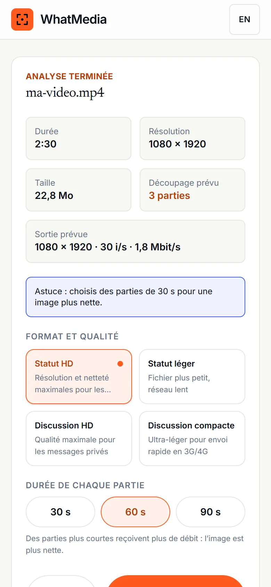
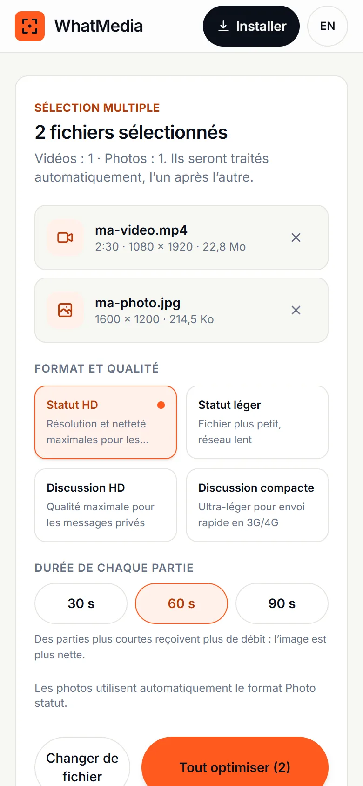
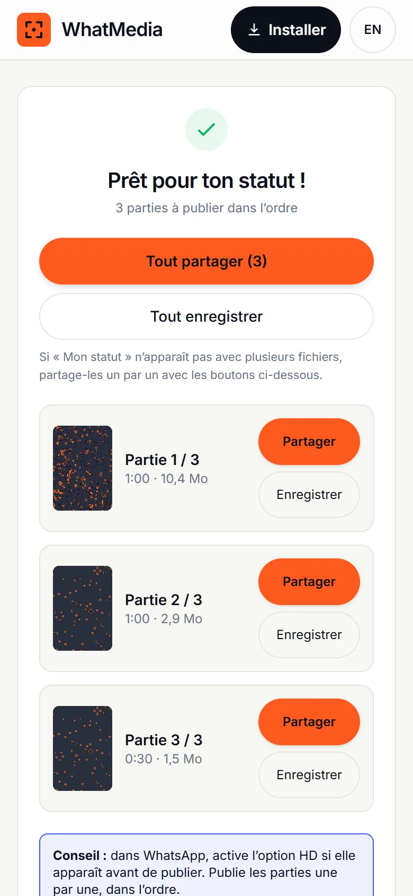

<div align="center">


# WhatMedia

**Tes statuts WhatsApp, préparés pour rester nets.**
Prepare your videos and photos for WhatsApp status, right on your phone.

[Ouvrir l’app](https://whatmedia.nealix.org/app/) · [Site](https://whatmedia.nealix.org) · [Fonctionnalités](https://whatmedia.nealix.org/fonctionnalites/) · [Contribuer](CONTRIBUTING.md)

[](https://github.com/rogerfarolix/whatmedia/actions/workflows/ci.yml)
[](https://whatmedia.nealix.org/statistiques/)
[](https://github.com/rogerfarolix/whatmedia/stargazers)
[](https://github.com/rogerfarolix/whatmedia/graphs/contributors)
[](https://github.com/rogerfarolix/whatmedia/commits/main)






</div>

## Ce que fait WhatMedia

Une vidéo nette dans ta galerie arrive souvent floue, délavée ou coupée dans les statuts WhatsApp. WhatMedia prépare le fichier **avant** l’envoi, dans ton navigateur :

- **Découpage** en parties de 30, 60 ou 90 secondes, chacune **sous 16 Mo**, avec le débit le plus élevé possible.
- **Vérification de la taille** après encodage, avec un nouvel essai plus léger si une partie dépasse.
- **Couleurs HDR** des iPhone (HLG, PQ, Dolby Vision) converties en SDR BT.709.
- **Photos** redimensionnées sans déformation, métadonnées (dont le GPS) supprimées, JPEG sRGB.
- **Sélection multiple** : jusqu’à 20 photos et vidéos traitées automatiquement, puis « Tout partager ».
- **Serveur de secours** facultatif, uniquement avec ton accord, fichier supprimé sous 15 minutes.
- Gratuit, sans compte, sans traceur, installable, utilisable hors ligne, en français et en anglais.
- [Statistiques publiques](https://whatmedia.nealix.org/statistiques/) : un compteur anonyme de fichiers préparés (type et nombre de parties seulement, désactivable), jamais de personnes.

> WhatMedia ne désactive pas la compression de WhatsApp : personne ne le peut. Il prépare le meilleur fichier de départ possible. Aucune mesure de qualité n’est publiée tant qu’elle n’a pas été faite sur de vrais statuts WhatsApp ([protocole](docs/08-TESTS-QUALITE.md)).

## Utiliser

1. Ouvre **https://whatmedia.nealix.org/app/** dans Safari (iPhone, iOS 16.4+) ou Chrome (Android).
2. Choisis une ou plusieurs vidéos ou photos.
3. Vérifie l’analyse, choisis la durée des parties, lance l’optimisation.
4. **Partager** → WhatsApp → **Mon statut**, partie par partie et dans l’ordre.

Pour l’installer : Safari → Partager → « Sur l’écran d’accueil », ou Chrome → « Installer l’application ».

## Comment c’est construit

| Dossier | Rôle | Technologies |
|---|---|---|
| [`apps/app`](apps/app) | L’application (PWA, servie sous `/app/`) | React 19, Vite, Zustand, Web Worker |
| [`apps/web`](apps/web) | Le site public FR/EN | Astro 5, Tailwind CSS 4 |
| [`apps/api`](apps/api) | Le serveur de secours facultatif | Fastify 5, ffmpeg, ffprobe |
| [`packages/core`](packages/core) | Le moteur : analyse, plan de découpage, encodage | TypeScript, Mediabunny, WebCodecs |
| [`packages/config`](packages/config) | Presets, limites WhatsApp, jetons de design | JSON validé par Zod |

Toutes les valeurs de compression vivent dans [`packages/config/src`](packages/config/src), jamais dans le code. Le détail est dans [`docs/`](docs/) : [vision](docs/00-VISION.md), [architecture](docs/02-ARCHITECTURE.md), [pipeline média](docs/03-PIPELINE-MEDIA.md), [API](docs/04-API.md), [déploiement](docs/06-DEPLOIEMENT.md), [sécurité](docs/07-SECURITE-VIE-PRIVEE.md), [tests](docs/08-TESTS-QUALITE.md), [feuille de route](docs/09-ROADMAP-TACHES.md).

### Utiliser le moteur dans ton projet

`@whatmedia/core` n’est pas encore publié sur npm. Tu peux l’utiliser depuis ce dépôt (workspace pnpm) :

```ts
import { probe, plan, run, detectCapabilities } from '@whatmedia/core';

const info = await probe(file);
const p = plan(info, 'status-hd', await detectCapabilities(), { segmentDurationSec: 30 });
const parts = await run(file, p, { onProgress: (x) => console.log(Math.round(x.ratio * 100)) });
// parts : OutputFile[], chaque fichier sous 16 Mo
```

## Développer

Prérequis : Node.js 22+, pnpm, et ffmpeg pour les tests de bout en bout du serveur.

```bash
git clone https://github.com/rogerfarolix/whatmedia.git
cd whatmedia
pnpm install
pnpm dev            # site + app (et l’API si WHATMEDIA_API_ENABLED=true)
```

| Commande | Effet |
|---|---|
| `pnpm lint` / `pnpm typecheck` | ESLint et TypeScript strict sur tout le monorepo |
| `pnpm test` | Tests unitaires (Vitest), dont l’API avec un vrai ffmpeg |
| `pnpm test:e2e` | Tests Playwright de l’app (Chromium et WebKit iPhone) |
| `pnpm build` | Construit les paquets, le site et l’app |

## Auto-héberger

Le site, l’app et le serveur de secours tiennent dans deux conteneurs :

```bash
docker compose -f deploy/docker-compose.server.yml up -d --build
```

Le conteneur `web` écoute sur `127.0.0.1:8096` et relaie `/api/v1` vers le conteneur `api`. Place devant n’importe quel reverse proxy HTTPS (nginx, Caddy…). Guide complet : [`docs/06-DEPLOIEMENT.md`](docs/06-DEPLOIEMENT.md).

## Contribuer

Les tests sur appareils réels, les mesures sur WhatsApp et les traductions sont les contributions les plus utiles. Lis [CONTRIBUTING.md](CONTRIBUTING.md) et le [code de conduite](CODE_OF_CONDUCT.md). Pour une faille de sécurité, suis [SECURITY.md](SECURITY.md).

## English

WhatMedia is a free, open source web app that prepares videos and photos for WhatsApp status on the device: it splits long videos into 30/60/90 s parts that each stay under 16 MB, converts iPhone HDR colours to SDR, strips photo metadata, processes up to 20 files in one go and hands them to WhatsApp through the native share sheet. An optional fallback server is only used with explicit consent. It does not bypass WhatsApp compression.

## Licence

Code sous licence [MIT](LICENSE). Un projet [Nealix](https://www.nealix.org) conçu par Roger Gnanih.

WhatMedia n’est ni affilié, ni sponsorisé, ni validé par WhatsApp LLC ou Meta Platforms, Inc. WhatsApp est une marque de Meta Platforms, Inc.
